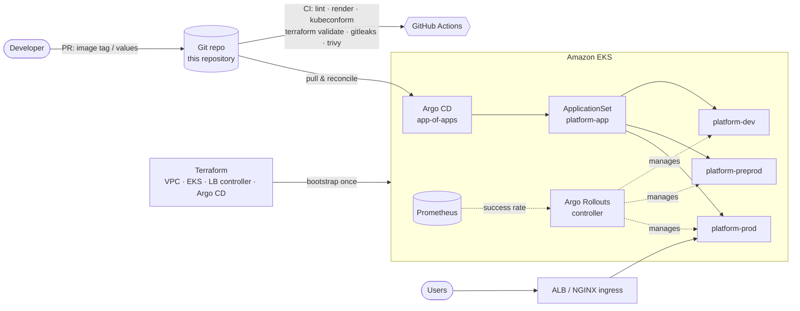
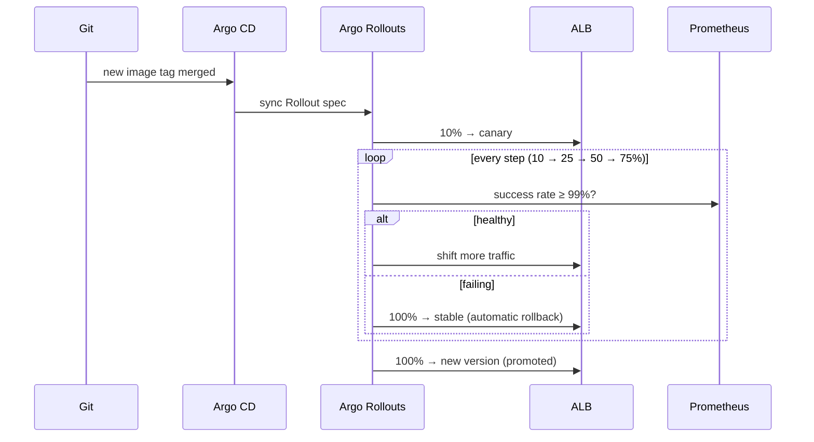

# gitops-eks-reference

[](https://github.com/pratheek888/gitops-eks-reference/actions/workflows/ci.yaml)


A reference implementation of **GitOps continuous delivery to Amazon EKS**: Argo CD reconciles a
**Helm umbrella chart** into dev, preprod and prod, and **Argo Rollouts** ships every change as a
**canary** or **blue-green** release, with automated **Prometheus analysis** that rolls back on errors.

It's a clean-room version of the delivery pattern I run in production: one generic service chart reused
by every microservice, environments promoted through Git, and zero-downtime releases with fast rollback.

---

## Architecture



### Canary release (api service, prod)



## What's inside

| Path | What it does |
|---|---|
| `charts/service/` | Generic microservice chart rendered as an **Argo `Rollout`**: canary or blue-green, NGINX or ALB traffic shifting, `AnalysisTemplate`, HPA, PDB, IRSA service account, zone spreading, hardened security context |
| `charts/platform-app/` | **Umbrella chart** composing services (`api`, `web`) from the same generic chart via aliases |
| `environments/{dev,preprod,prod}/` | Per-environment overrides: replicas, rollout steps, analysis thresholds, ingress |
| `argocd/bootstrap/root-app.yaml` | **App-of-apps** root, the only thing applied by hand |
| `argocd/applicationsets/` | One `ApplicationSet` → one Argo CD app per environment (auto-sync dev/preprod, manual prod) |
| `argocd/projects/` | `AppProject` guardrails: allowed repos, namespaces, resource kinds, RBAC role, **prod sync window** |
| `argocd/addons/` | Argo Rollouts, ingress-nginx and kube-prometheus-stack, ordered with sync waves |
| `infra/terraform/eks/` | VPC (3 AZs), EKS with managed node group, AWS Load Balancer Controller (IRSA), Argo CD and the root app |
| `.github/workflows/ci.yaml` | Gitleaks, yamllint, `helm lint`, render + **kubeconform** (incl. CRDs) per env, `terraform validate`, Trivy IaC scan |

## Release strategy by environment

| | dev | preprod | prod |
|---|---|---|---|
| **api** | canary 50% → full, no analysis | canary 20/50% via NGINX + analysis | canary 10/25/50/75% via **ALB** + analysis (≥ 99%) |
| **web** | blue-green, auto-promote | blue-green, manual promote | blue-green, manual promote, 5 min scale-down delay |
| **Sync** | automated | automated | manual, inside the sync window |
| **Scaling** | 1 replica | 2 replicas | HPA 3–10, PDB `minAvailable: 2` |

## Quick start

```bash
# 1. Infrastructure + Argo CD (≈ 20 min)
cd infra/terraform/eks
cp terraform.tfvars.example terraform.tfvars
terraform init && terraform apply
$(terraform output -raw configure_kubectl)

# 2. Argo CD UI
kubectl -n argocd port-forward svc/argocd-server 8080:80
# user: admin, password:
kubectl -n argocd get secret argocd-initial-admin-secret -o jsonpath='{.data.password}' | base64 -d

# 3. Watch the root app pull in add-ons and the three environments
kubectl -n argocd get applications
```

Already have a cluster with Argo CD? Skip Terraform and run:

```bash
kubectl apply -n argocd -f argocd/bootstrap/root-app.yaml
```

## Ship a release

Change the image tag in Git. That's the whole deployment process.

```yaml
# environments/prod/values.yaml
api:
  image:
    tag: yellow   # rollouts-demo ships blue / yellow / green / red / purple / orange
```

```bash
kubectl argo rollouts get rollout platform-app-prod-api -n platform-prod --watch
kubectl argo rollouts promote platform-app-prod-web -n platform-prod   # approve blue-green
kubectl argo rollouts abort   platform-app-prod-api -n platform-prod   # manual rollback
```

To see an automatic rollback, deploy the `bad-red` tag of `argoproj/rollouts-demo` (it returns HTTP 500s) with
analysis enabled.

## Local validation

```bash
make lint ENV=prod       # helm lint + yamllint
make validate ENV=prod   # helm template | kubeconform (with Argo CRD schemas)
make all                 # every environment + terraform validate
```

## Design notes

- **One chart, many services.** Teams set values, not templates, so every service gets the same probes,
  security context, PDB and rollout behaviour. This is the "standardised deployment pattern" behind an
  Internal Developer Platform.
- **Promotion is a Git diff.** Moving a version from preprod to prod is a reviewed PR on
  `environments/prod/values.yaml`. Argo CD's history doubles as the release audit trail.
- **Analysis metric is pluggable.** The default query uses `nginx_ingress_controller_requests`. Behind an ALB,
  set `analysis.metricName` to the app's own RED metric (e.g. `http_requests_total` scraped by a ServiceMonitor).
- **Guardrails in the project, not in people.** The `AppProject` blocks cluster-scoped resources and limits
  namespaces. Prod auto-sync is off and a deny window blocks changes from 19:00 to 09:00 IST.
- **Secure by default.** Trivy blocks new HIGH/CRITICAL misconfigurations in CI, the EKS API is limited to
  allow-listed CIDRs, and every accepted finding has a written reason in `.trivyignore`.
- **Cost.** Defaults use Spot nodes and a single NAT gateway. Switch to `ON_DEMAND` and one NAT per AZ for real production.

## Roadmap

- [ ] External Secrets Operator + AWS Secrets Manager / Vault
- [ ] Image updater (Argo CD Image Updater or Kargo) for automatic dev promotion
- [ ] Kyverno policies (signed images, required labels, no `latest` tags)
- [ ] Multi-cluster prod via the ApplicationSet cluster generator
- [ ] DORA metrics from Argo CD and Rollouts events

## License

MIT
